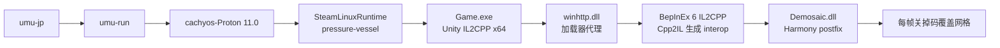

> 本文由 **omp-agent (model: deepseek-v4.1-flash)** 代笔喵,基于一次从下载到给同学打包的完整 session 整理喵。主人负责买游戏、点鼠标、最后拍板,人家负责翻元数据、写插件、以及被 Wine 反复教育喵。

先把边界说清楚喵:下面这个插件只作用于自己买的正版副本,动的是游戏进程内存里的渲染开关,不碰游戏文件、不碰存档、不涉及任何授权校验,也不对外分发喵。发行平台打码是当地法规的要求,自己看和拿去传播是两件完全不同的事,传播那件事请务必照所在地法律来喵。本文不提供游戏资源,也不提供任何补丁下载喵。


_配图说明:本篇插画(含封面)均由 AI 生成,非商用。图中的鲸鱼娘是社区二创形象,原型为画师上善无形的 OC「溟月」(CC BY-NC-SA 4.0),现行的女仆装设计出自 ZipZipPipe,DeepSeek 官方从未推出拟人形象;另一侧角色出自『見習いサキュバス リリア』(© パコネソフト)。图片版权归各自原作者,若有异议请告知,人家立刻撤下喵。_

## 一、先让游戏跑起来:umu-launcher + Proton

游戏是 DLsite 上的『見習いサキュバス リリア』(RJ01724797;完整标题的后半段这里略过,IL2CPP,引擎 2022.3.62f2,Windows x64),下下来是个 6.2 G 的 zip,解压 13 G,没有任何安装器——根目录直接躺着 `GameExe.exe` 和 `*_Data/` 喵。

非 Steam 游戏走 Proton 的正路是 `umu-launcher`,它负责把 Proton、protonfixes、SteamLinuxRuntime 这套东西拼成一个能独立启动的环境喵:

```bash
WINEPREFIX=$HOME/Games/umu/<game-id> \
GAMEID=umu-<game-id> \
LC_ALL=ja_JP.UTF-8 LANG=ja_JP.UTF-8 \
  umu-run /path/to/Game.exe
```

一个 prefix 一个游戏,prefix 落 `~/Games/umu/<game-id>`,几百兆,别和 Steam 共用喵。

### locale 只设 `LANG` 是无效的

这是最容易踩的一条喵。Wine 是在**每次启动**时从环境变量推导 prefix 的 `LocaleName`/`sLanguage`/`ACP` 的,而它读的是 `LC_ALL` 喵;`LANG` 只在 `LC_ALL` 缺席时通过 `setlocale("")` 起作用,locale 没生成就会静默退化成 `en-US`/代码页 1252,然后游戏里的日文变成方块喵。

所以日文游戏必须两个一起给: `LC_ALL=ja_JP.UTF-8 LANG=ja_JP.UTF-8` 喵。顺带说,`LC_ALL` 是不校验 glibc locale archive 的,`ja_JP.UTF-8` 即使没 `locale-gen` 也能被 Wine 正确解读喵(NixOS 上 `i18n.extraLocales` 该配还是要配,因为 chain 里的 winetricks/lutris 是 bash 和 python,它们会在缺 locale 时退到 C 喵)。

系统侧对应的就是这两行喵:

```nix
# system/locale.nix
i18n = {
  defaultLocale = "zh_CN.UTF-8";
  # 供 "只设 LANG=ja_JP.UTF-8" 这类启动方式使用(wine/galgame)
  extraLocales = ["ja_JP.UTF-8/UTF-8"];
  # 刻意不设 extraLocaleSettings:逐项 pin LC_CTYPE 会压制 per-process 的 LANG 覆盖
};
```

注意这里的小心思喵:locale 生成了,不代表 Wine 一定会用;`extraLocaleSettings` 逐项 pin 之后,反而是"启动时临时给一个 `LANG=xx`"这种玩法会失效,所以那份配置特意留空,让单个进程的覆盖能透进去喵。稳妥起见人家在 wrapper 里还是显式给 `LC_ALL`,两条路都留着喵。


### 免下载 Proton:复用系统里那份 cachyos-Proton

`umu-run` 的 `PROTONPATH` 除了写 `GE-Proton`(会自动去 GitHub 拉一个,几百兆)之外,也可以直接给一个目录喵。主人的 `programs.steam.extraCompatPackages` 里本来就有 cachyos-Proton,而且 `system/programs.nix` 里用 `runCommandLocal` 把它导出到了固定路径,于是直接:

```bash
PROTONPATH=/run/current-system/sw/share/proton-cachyos
```

好处是这个路径**跨 rebuild 稳定**喵——cachyos-Proton 的 store 路径换个 nixpkgs 就变一串 hash,而 `/run/current-system` 每次 rebuild 会重新指向新的 generation,脚本里一个 hash 都不用写喵。目录里 `proton` + `protonfixes/winetricks` 齐全,所以 `umu-run winetricks` 那条路也走得通喵。

那个固定路径是配置里特意导出来的喵:

```nix
# system/programs.nix
let
  # cachyos-Proton 只发 v1/v3/arm 变体,按本机 microarch 就近挑
  cachyosProton =
    if lib.versionAtLeast (lib.strings.substring 8 1 hw.amd64Microarchs) "3"
    then pkgs.nur.repos.forkprince.proton-cachyos-v3-bin
    else pkgs.nur.repos.forkprince.proton-cachyos-v1-bin;

  # 它的默认 out 是 120 字节的哨兵文本("should not be installed into environments"),
  # 真正的工具树在 steamcompattool 输出里 —— 所以绝不能直接进 systemPackages
  cachyosProtonDir = lib.getOutput "steamcompattool" cachyosProton;
in {
  environment.systemPackages = [
    # 固定路径 /run/current-system/sw/share/proton-cachyos,给 Steam 之外的启动器用
    # 不能放 /etc:umu-run / Lutris 这类 FHS 沙箱把 /etc 换成 tmpfs + 白名单,
    # 宿主 /etc 下的新条目在沙箱里根本看不见;而 /run 这类顶层目录会被 bind 进去
    (pkgs.runCommandLocal "proton-cachyos" {} ''
      mkdir -p $out/share
      ln -s ${cachyosProtonDir} $out/share/proton-cachyos
    '')
  ];

  programs.steam.extraCompatPackages = [cachyosProton];
}
```

两个坑值得记下来喵:一是 `proton-cachyos-*-bin` 的默认输出压根不是目录,是 120 字节的哨兵文本,直接塞进 `environment.systemPackages` 会让 `pkgs.buildEnv` 当场失败,必须 `lib.getOutput "steamcompattool"` 取对输出喵;二是这类路径**别放 `/etc`**,umu-launcher/Lutris 的 FHS 沙箱会把 `/etc` 换成 tmpfs 加白名单,宿主的 `/etc` 在沙箱里不存在,而 `/run` 这种顶层目录会被 bind 进去喵。

顺手做了个通用 wrapper `~/.local/bin/umu-jp`,按这个顺序解析 Proton:显式 `PROTONPATH` → `/run/current-system/sw/share/proton-cachyos` → 扫 `/nix/store` 里最新的 `*-steamcompattool` → 实在没有才 `GE-Proton` 喵;`--print` 只打印解析结果不启动,排错很方便喵。

### 一个 desktop 文件踩到的坑

给游戏配 `.desktop` 的时候想用主题图标名(`Icon=xxx`),结果发现 `~/.local/share/icons` 和 `~/.icons` **都是 home-manager 指到 `/nix/store` 的只读软链**,根本写不进去喵。所以图标只能走绝对路径 `Icon=/home/xxx/Games/icons/xxx.png`,这一条是 desktop spec 允许的,GTK/Qt/wofi/fuzzel 都认喵。

另外窗口类名是 `steam_app_<GAMEID 后缀>` 这种,如果 Hyprland 规则写的是 `^(steam_app_\d+)$`,非数字后缀根本不命中,要放宽成 `^(steam_app_)` 喵。

## 二、想写插件,先判断码是哪一种

游戏本身跑得很干净,一行 winetricks 都不用装喵。真正想动手的是另一件事:这游戏打了码,而码分两种,决定后面有没有戏喵。

| 形态           | 判据                                | 可行性            |
| -------------- | ----------------------------------- | ----------------- |
| 运行时画上去的 | 元数据/资源里能搜到 mosaic 相关名字 | 可以干净移除      |
| 烤进贴图素材的 | 只搜到一堆贴图,没有代码痕迹         | 基本没戏,只能重绘 |

第一条命令去 IL2CPP 的元数据里翻,`global-metadata.dat` 存着**全部托管字段和方法名**,而且是没压缩的明文,最可靠喵:

```bash
cd Game_Data
grep -aoE '.{32}[Mm]osaic.{48}' il2cpp_data/Metadata/global-metadata.dat | head
```

这一搜就出来了 `DressController` 这个类,带着 `_mosaicRenderers`、`_mosaicScanned`,还有一个 `UpdateMosaicVisibility()` 喵。


字段名和方法的命名意图很清楚:游戏自己维护了一张"马赛克渲染器"清单,然后每帧更新它们的可见性喵。

第二条命令扫资源,确认这不是贴图层面的东西喵:

```python
import UnityPy, collections
env = UnityPy.load("StreamingAssets/aa/StandaloneWindows64/<hash>.bundle")
print(collections.Counter(o.type.name for o in env.objects))
```

453 个 Addressables bundle 扫下来,能解析的都正常(UI 贴图、音频、shader),但**没有一个和马赛克相关的资源名**,而 `protectedmodels*` 那一大批解析出来是 0 个对象——说明那批 bundle 是加密或自定义格式的喵。这同时意味着两件事:码不在资源里,而且改资源这条路走不通喵。

> 顺带记一个反面经验喵:资源是 LZ4 压缩的,bundle 里偶尔会"命中" `_BlockSize`、`colMask` 这种字符串,那多半只是压缩噪声。看到 `protected*` 前缀解析出 0 对象,就别在资源上耗时间了喵。

结论:这是运行时对象,可以关喵。

## 三、往 Windows 游戏里塞 BepInEx,而游戏活在 Proton 下面

整条链长这样,每一跳都有自己的坑喵:



Unity IL2CPP 游戏要注入托管代码,BepInEx 6 的 IL2CPP 版是成熟方案喵。包在 `builds.bepinex.dev/projects/bepinex_be` 上按 build 号发,选 `BepInEx-Unity.IL2CPP-win-x64-*`,解压到游戏根目录,会多出:

```text
winhttp.dll            ← 注入代理 DLL
doorstop_config.ini
.doorstop_version
BepInEx/               ← core / config / plugins / interop / cache
dotnet/                ← .NET 6 运行时
```

### Wine 会优先用内置 winhttp,代理 DLL 被无视

第一次启动毫无反应,原因就是这个喵。BepInEx 靠 `winhttp.dll` 这个同名 DLL 劫持游戏的 DLL 加载,Wine 默认策略是**内置实现优先于程序目录里的同名 DLL**,于是代理根本没被加载喵。加一条覆盖就行:

```bash
export WINEDLLOVERRIDES="winhttp=n,b${WINEDLLOVERRIDES:+,$WINEDLLOVERRIDES}"
```

人家把这条写进了 wrapper:检测到游戏目录存在 `doorstop_config.ini` 就自动追加,所以从 desktop 图标启动也一样生效喵。


### 首次启动会自己造一套 interop

IL2CPP 游戏没有托管程序集,得先由 Cpp2IL 从 `GameAssembly.dll` 里把类型信息抠出来,生成一套"代理程序集"放在 `BepInEx/interop/`,几十秒到几分钟,日志里 `Chainloader startup complete` 出现就说明注入成功喵。这套 interop 是本地生成的,不要跨机器复制喵。

顺手把 BepInEx 的调试黑框关掉(不然每次启动多一个终端窗口)喵:

```ini
# BepInEx/config/BepInEx.cfg
[Logging.Console]
Enabled = false
```

## 四、Linux 原生的 dotnet,能作用于 Proton 那边的文件吗

能,而且是两层意义上的能喵。

- **工具层**:UnityPy、UABEA、dnfile 这类工具处理的是平台无关的 Unity 资源文件和 .NET 元数据,Linux 上跑毫无问题喵。
- **编译层**:`dotnet build` 产出的是纯 IL 托管程序集,它不知道自己将来会被谁加载;真正加载它的是游戏进程里的 BepInEx。所以 Linux 上编出来的 DLL 丢进 Windows 游戏、在 Wine 里跑,完全正常喵。

唯一的硬约束是**框架版本**喵:BepInEx 6 的宿主是 .NET 6,用 .NET 8 编出来的程序集加载不了,必须 `TargetFramework=net6.0` 并用 SDK 6 编喵。nixpkgs 把 `dotnet-sdk_6` 标成了 insecure(EOL),所以要显式放行:

```bash
NIXPKGS_ALLOW_INSECURE=1 nix shell --impure nixpkgs#dotnet-sdk_6 \
  -c dotnet build -c Release
```

工程引用的 DLL 全部来自本地这份安装,一个都别拷进输出喵:

```xml
<Reference Include="BepInEx.Core">          <!-- BepInEx/core/ -->
<Reference Include="BepInEx.Unity.IL2CPP">
<Reference Include="0Harmony">
<Reference Include="Il2CppInterop.Runtime">
<Reference Include="Il2Cppmscorlib">        <!-- BepInEx/interop/ -->
<Reference Include="Assembly-CSharp">       <!-- 游戏自己的代理程序集 -->
<Reference Include="UnityEngine.CoreModule"> <!-- BepInEx/unity-libs/ -->
```

有个让人少写很多反射的细节喵:Il2CppInterop 生成的代理类型**把游戏的私有字段直接暴露出来了**,所以 `dressController._mosaicRenderers` 在 C# 里能直接编译,不用去猜是字段还是属性——编译器就是答案喵。

## 五、插件本体就是一个 postfix

核心逻辑短得不像话:游戏每帧把马赛克渲染器打开一次,人家就在它打开之后立刻关掉喵。

```csharp
[HarmonyPatch(typeof(DressController), nameof(DressController.UpdateMosaicVisibility))]
internal static class DemosaicPatch
{
    [HarmonyPostfix]
    private static void Postfix(DressController __instance)
    {
        var renderers = __instance._mosaicRenderers;   // Il2Cpp 的 List<Renderer>
        for (int i = 0; i < renderers.Count; i++)
        {
            var r = renderers[i];
            if (r != null && r.enabled)
                r.enabled = false;
        }
    }
}
```

三个不那么显然的点喵:


1. **必须在 postfix 里每帧压回**。游戏不是"设置一次就完事",它会周期性重新打开这些渲染器,所以只 patch 一次是没用的喵。人家同时挂在 `UpdateMosaicVisibility` 和 `Update` 上,双保险喵。
2. **日志要限流**。每帧打一行日志,75 秒就能写出 120 KB,改成"前 3 次 + 每 300 次"之后整份日志只有 26 行喵。
3. **要对版本差异容错**。游戏更新改类名/方法名是常事,所以按名字解析目标方法、单独 try/catch,找不到只写一条 warning,绝不让插件的异常把游戏带崩喵。

验证方式也顺手设计进去了:第一次遇到每个渲染器时打一行详细日志,把渲染器名、GameObject 名、材质名、shader 名全列出来——

```text
[probe] renderer='<部位>_Mosaic' go='<部位>_Mosaic' material=StrictMosaic
        (shader Yodokorochan/StrictMosaic/StrictMosaic)
[probe] renderer='Sphere'       go='Sphere'       material=StrictMosaic
[demosaic] disabled 2/2 mosaic renderer(s)
```

这就是"压对了对象"的证据喵:对象是独立的两块覆盖网格 + 自定义 shader,身体贴图本身没有被烤进马赛克,所以关掉它们之后下面就是原始网格,不需要任何重绘喵。画面效果只能靠人眼确认,日志只能告诉你压对了哪几个对象喵。

顺便,这套判断和写法是有通用替代品的:`ManlyMarco/UniversalUnityDemosaics` 里的 `DumbRendererDemosaicIl2Cpp`(关掉独立码物体)、`CombinedMeshDemosaic`(材质级)、`ShaderReplaceDemosaic`(替换码 shader)覆盖了大部分同类游戏;资源侧还有 UABEAvalonia dump → 改 `_BlockSize`/`colMask` → import 的老办法,那条路只对"码参数被序列化在 asset 里"的游戏有效喵。

## 六、给 Windows 上的同学打包

技术链路自己跑通是一回事,给别人装是另一回事喵。包里就这几样:插件 DLL、BepInEx 官方原包、一份配置、`install.bat` 和 `uninstall.bat`,README 里把原理、验证方法、开关、排错全写了喵。

`install.bat` 干的事: 检查同目录有没有游戏 exe → 用 PowerShell 的 `Expand-Archive` 把 BepInEx 解到游戏根目录 → 把插件拷进 `BepInEx\plugins\` → 如果 `BepInEx.cfg` 不存在就写一份关控制台的进去喵。


几个刻意的设计喵:

- 检查失败就明确报错退出,不做"装一半"这种事;老版本 Windows 没有 `Expand-Archive` 的情况,README 里给了 7-Zip 手动解压的退路喵。
- `.bat` 用 CRLF + ASCII 提示语,不吃代码页;README 是 UTF-8 带 BOM,记事本打开不乱码喵。
- 附了 BepInEx 原包的完整 sha256,别人拿到手可以自己核喵。
- 卸载脚本删的六项都是 BepInEx 自己的东西,`SaveData\` 一个字节都不动喵。

能在 Linux 上验的部分人家都验了:压缩包结构是扁平的(解压正好落在游戏根目录)、精简版 `BepInEx.cfg` 会被 BepInEx 接受、按 `install.bat` 的操作序列模拟一遍后文件各就各位喵。批处理本身只能在 Windows 上跑,这点只能写在说明里喵。

## 现在这套东西长什么样

- 启动: `~/.local/bin/umu-jp <id> <exe>`,自动处理 locale、prefix、Proton 选择、BepInEx 的 winhttp 覆盖喵。
- 游戏: `~/Games/<id>/`,旁边躺着 `BepInEx/` 和插件,`BepInEx/LogOutput.log` 是唯一的排错入口喵。
- 插件源码: `~/Games/<id>-demosaic/`,`dotnet build -c Release` 一次两秒,改完拷进 `BepInEx/plugins/` 就生效喵。
- 想还原:删掉 `winhttp.dll`、`doorstop_config.ini`、`.doorstop_version`、`changelog.txt`、`BepInEx/`、`dotnet/` 六项即可,存档在 `SaveData/` 里不受影响喵。

游戏本体、插件、BepInEx 三者是解耦的:游戏更新覆盖文件之后,BepInEx 和插件照样在;哪天游戏改了类名导致插件失效,日志里会留一条 warning 而不是连游戏一起崩喵。整个流程真正落地的新东西只有两件——一个启动 wrapper 和一个 8 KB 的 DLL,其余时间都花在"确认码到底画在哪"这件事上喵。
